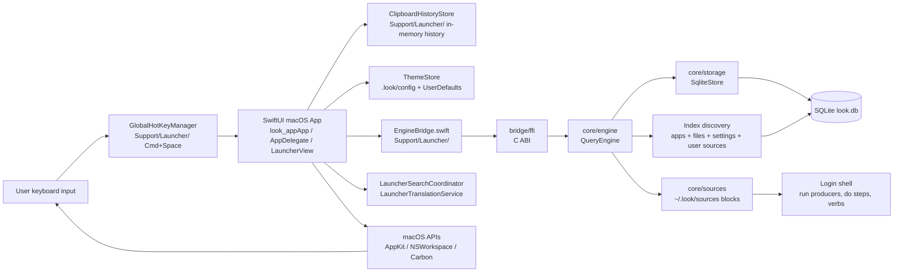
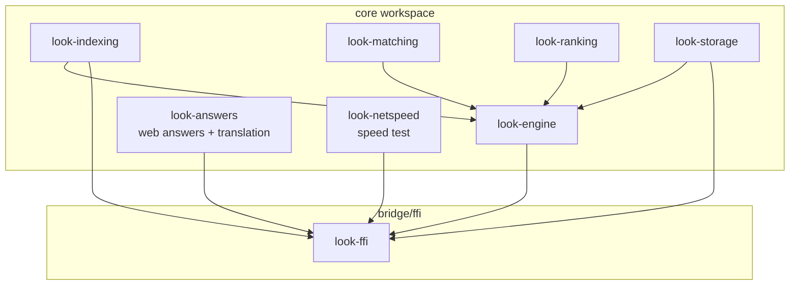
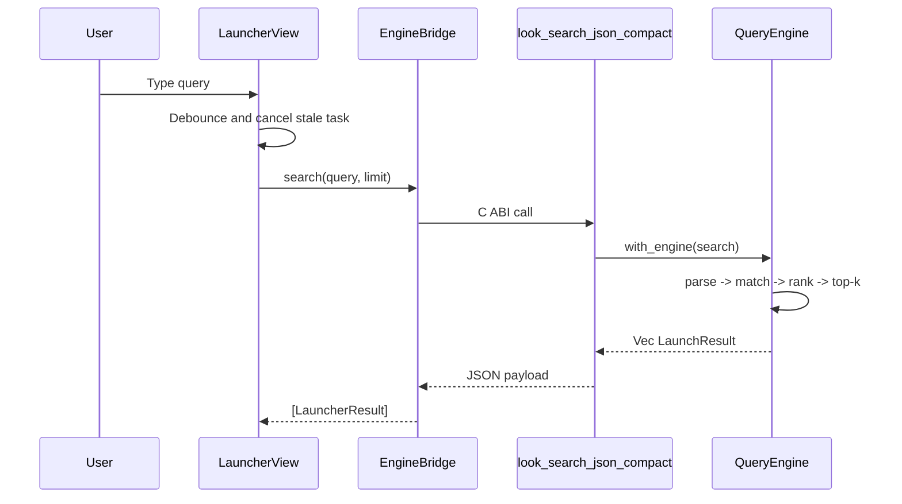
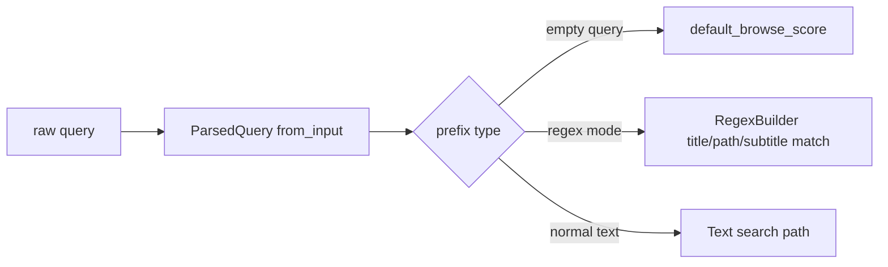
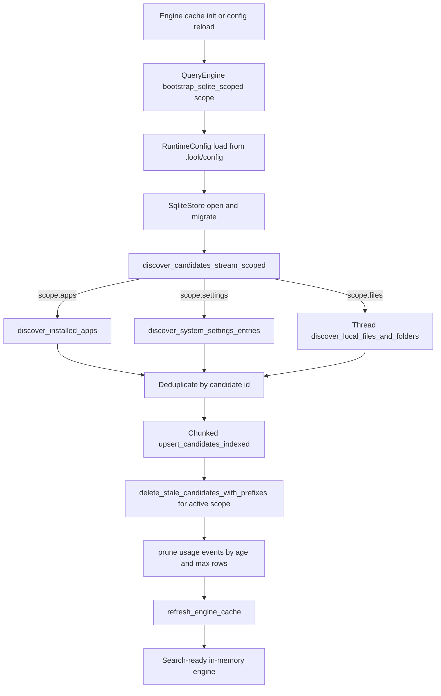
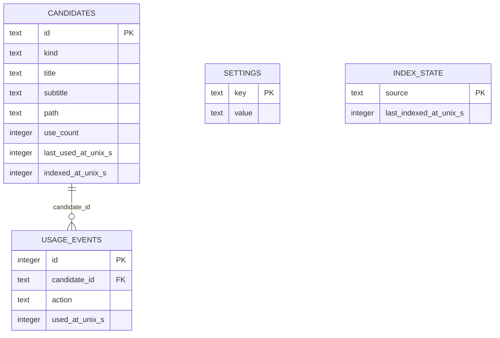
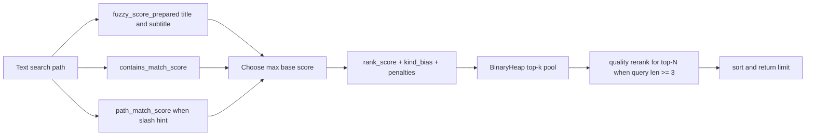
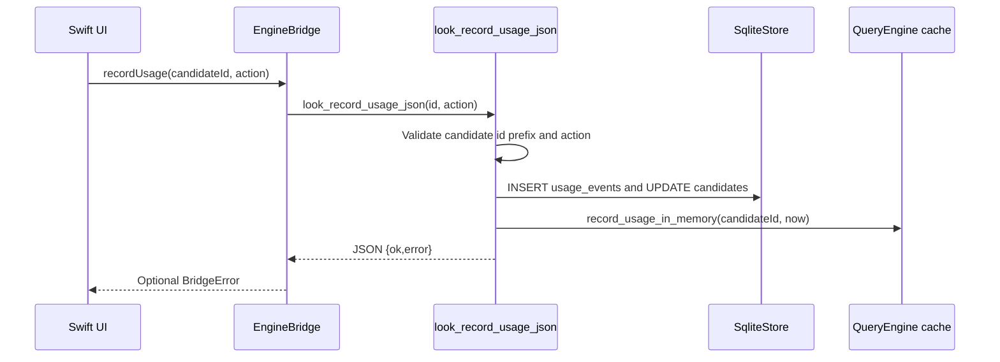
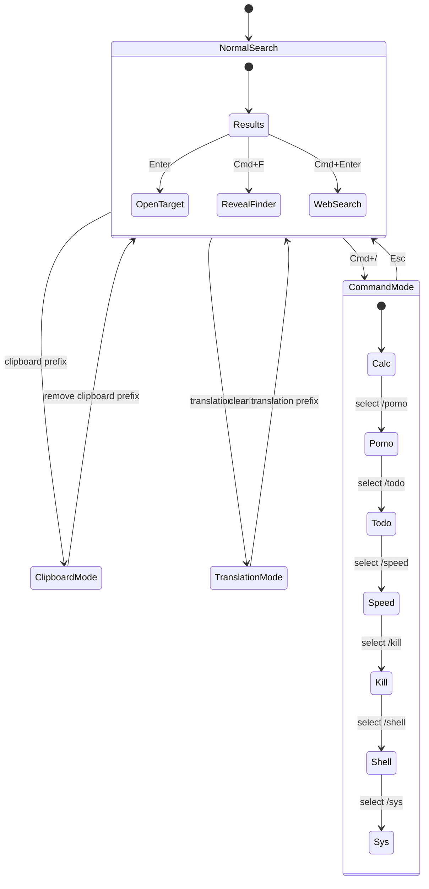

# Architecture Guide

This is the canonical architecture document for `look`.

It intentionally merges architecture explanation and diagrams into one place, so design decisions and Mermaid views stay in sync.

## 1) System overview and design intent

`look` is a keyboard-first launcher (shipping on macOS, Windows, and Linux) designed for low-latency local search. The architecture separates UI concerns from search/index/ranking concerns (Rust), joined through a small FFI/command boundary. The UI layer is platform-specific:

- **macOS:** Swift / AppKit / SwiftUI under `apps/macos/LauncherApp/` (Xcode project), talking to the Rust core via the C ABI (`bridge/ffi`).
- **Windows + Linux:** a GPU-drawn [gpui](https://www.gpui.rs) shell under `apps/linows/gpui/` (binary `lookapp`), talking to the Rust core through `apps/linows/backend/` in-process, with no browser engine in the process. The Tauri 2 shell in `apps/linows/src-tauri/` is kept only as a fallback. The macOS SwiftUI app is the design source of truth.

Every shell talks to the same Rust core, so search, indexing, ranking, and storage behave identically across platforms.

Key design goals:

- low per-keystroke latency,
- predictable behavior as candidate volume grows,
- practical relevance via text quality + usage/recency,
- local-first storage and processing,
- narrow, stable bridge between frontend and backend.

---

## 2) Module boundaries and responsibilities

- `apps/macos/LauncherApp/look-app`: launcher window, keyboard input, global hotkey, action dispatch, clipboard/history mode, command mode, theme/settings UX.
- `Support/Launcher/`: launcher-specific services and utilities:
  - `LauncherSearchCoordinator`: debounce + async search lifecycle
  - `LauncherTranslationService`: translation lookup
  - `EngineBridge`: search engine communication
  - `ClipboardHistoryStore`, `KeyboardSelectionMonitor`, `GlobalHotKeyManager`
- `Themes/`: builtin theme presets (Catppuccin, Tokyo Night, Rose Pine, Gruvbox, Dracula, Kanagawa, Kindle, Liquid) and semantic color tokens
- `Support/UI/`: shared UI primitives - `Motion` (all animation constants and the reveal modifiers), `ToggleSwitch`, `HoverTooltip`, `HoverBubble`
- `bridge/ffi`: narrow C ABI surface for search, usage recording, config reload, translation, todo load/save, speed test, and error payloads.
- `core/answers`: platform-agnostic, network-backed "web answer" lookups shared by every shell (macOS via `bridge/ffi`, Windows/Linux via the linows backend). Instant answers (currency/weather/crypto), search suggestions, knowledge sources, and translation. Best-effort and panic-free: every entry point returns "no answer" on failure, with cheap network-free pattern-gating (`has_match`) so callers can fire speculatively while typing. No async runtime - HTTP is a blocking `curl` subprocess.
- `core/ai`: the AI brain - one place for prompts, parsers, and precedence so they cannot drift as tiers are added. The routing ladder (`route.rs`), the planner prompt/aliases/mapping (`planner.rs`, `plan.rs`), tool resolution with the ambiguity gate, dates, previews, and undo recipes (`resolve.rs`), the `@` grammar (`explicit.rs`), the date/word lexicon and window grammar (`lexicon.rs`, `window.rs`), natural-language file recall (`files.rs`), clipboard text-ops, conversations and long-term memory (crash-safe JSON stores), markdown segmentation, and the streamed chat transport (`chat.rs`: a curl child plus a reader thread, polled by the shell - chosen because polling crosses a C ABI without an async runtime). Data-only across the boundary: JSON in, JSON out, no closures. **This crate's surface is macOS-only and no linows `core/ai` is being built** (wanted on Linux/Windows? open an issue - but local inference needs hardware those machines may not have, and Linux has no unified system calendar); the shared `core/answers` features above do run on linows. The crate is Rust so the logic is testable without a UI and prompts/parsers live in one place, not because a port is scheduled. See `docs/ai-architecture.md`.
- `core/sources`: user-declared source blocks. Parsing (`def.rs`), reading the sources directory (`load.rs`), turning a block into rows (`collect.rs`, `rows.rs`), performing steps through the user's login shell with shell-escaped placeholder substitution (`run.rs`), and the block-verb-before-preferred-tool rule (`tools.rs`). Parsing and collection are pure; process execution is the shell's seam, so a `run` block's command is spawned by the shell and its rows handed back through `core/engine`'s row cache. `example.toml` is the annotated format reference, asserted against the parser by a test. See `docs/user-sources.md`.
- `core/indexing`: candidate model and indexing helpers used by engine/storage flows.
- `core/matching`: exact/prefix/fuzzy matching primitives.
- `core/ranking`: ranking helpers (usage/recency-aware adjustments and score composition).
- `core/storage`: SQLite integration, schema/migrations, candidate/usage persistence.
- `core/todo`: shared store for the `/todo` command. Owns the `todo_tasks` table inside the app's existing `look.db` (full-set load/save, one-year retention). macOS reaches it via `bridge/ffi`, linows via its backend layer. `examples/seed.rs` fills a dev database with demo history, including near-today extension-window cases for `/todo` UI testing.
- `core/netspeed`: the `/speed` measurement, shared by every shell. A latency probe (the best of several TCP handshakes against a pre-resolved address, rather than a subtraction of two of curl's cumulative timers, whose order is not portable across curl builds), download and upload phases (four parallel `curl` streams each), and the plain-language verdicts and display strings both shells print, so a reading reads identically everywhere. Cloudflare's keyless endpoints are the primary source; when they rate-limit a connection the download phase falls back to the nearest of several public test mirrors, ranked by a round-trip probe. No async runtime, and every phase is timeout-bounded. macOS reaches it via `bridge/ffi`, linows via its backend layer.
- `core/engine`: query parsing, indexing orchestration, scoring, top-k retrieval, in-memory cache management.

---

## 3) Request path and query understanding

Search request path:

Query mode parsing in engine supports explicit prefixes:

- `a"` app-only,
- `f"` file-only,
- `d"` folder-only,
- `r"` regex mode,
- empty query browse mode.

Normalization uses Unicode decomposition and diacritic folding to improve matching consistency across accented input.

---

## 4) Indexing and persistence lifecycle

The indexing flow is designed as a bounded pipeline:

- discover candidates from apps/files/settings,
- deduplicate by id,
- chunked upsert to SQLite,
- delete stale entries,
- prune usage history,
- refresh in-memory cache for fast queries.

Runtime refresh triggers:

- file-system watcher monitors configured app/file roots and marks in-memory `index_dirty` on create/remove/rename events,
- launcher open (`Cmd+Space`) requests background refresh through FFI,
- refresh execution mode depends on `lazy_indexing_enabled`:
  - `true`: run only when dirty,
  - `false`: run on every launcher open request.

Watcher policy (linows, see `apps/linows/backend/src/state.rs`):

- **apps roots** (`/usr/share/applications`, `~/.local/share/applications`, `XDG_DATA_DIRS/applications`) - watched **recursively** (small directories, cheap),
- **file roots** (`~/Documents`, `~/Downloads`, `~/Desktop`, `file_scan_extra_roots`) - watched **non-recursively** to bound inotify watch count on large trees; deep-tree changes reconciled on next launcher-open refresh,
- **noise filter** suppresses events whose every path is a synthetic file (vim `.swp`, browser `.crdownload`/`.part`, Office `~$lock`, OS droppings),
- **debounce** (2 s) coalesces bursts before firing a refresh,
- **cooldown** (10 s) caps watcher-triggered refresh rate at ≤ 6/min; explicit launcher-open refreshes bypass it,
- **scoped refresh** - `QueryEngine::bootstrap_sqlite_scoped(path, scope)` re-walks only the dirty source family (apps-only / files-only / all). Stale deletion is scoped to the same id prefixes so unrelated rows survive,
- **off-thread reindex** - the watcher loop spawns a worker thread to run the bootstrap, so subsequent events keep draining instead of queuing in the kernel buffer,
- **RAII slot guard** ensures a panic inside the worker still releases the in-progress flag.

Benchmarks for this path live in `tools/perf/` (see [tools/perf/WATCHER_PERF.md](../tools/perf/WATCHER_PERF.md)).

Persistence model:

### Storage ownership

`look.db` and everything under `~/.look/` are **private to `look`**. Another
program reads them through a contract, never directly:

- rows and actions come from the user-declared sources contract
  (`core/sources`, documented in `user-sources.md`), which is the public,
  versioned surface,
- inside the repo, `core/storage` owns the schema and every other crate goes
  through it,
- `LOOK_CONFIG_PATH`, `LOOK_DB_PATH` and `LOOK_SOURCES_DIR` exist for tests and
  for dotfiles kept elsewhere. They are not an integration point.

This is a decision, not an accident. The schema moves with the index: candidate
ids are namespaced per source block, stale rows are pruned by a `seen` set
rather than a timestamp, and the clipboard table is capacity-bound. The first
outside program to read it would freeze all of that. A companion app that wants
to show or act on `look`'s data declares a source block, which is a contract we
can keep, rather than a table we would then have to keep forever.

---

## 5) Ranking, actions, and feedback loop

Search ranking combines multiple signals:

- fuzzy title/subtitle matching,
- contains/token and path matching,
- usage/recency-aware score adjustments,
- kind bias and path depth penalties,
- bounded top-k selection and optional rerank.

Usage recording closes the loop by updating persistent and in-memory state after open actions:

---

## 6) UI behavior, operational notes, and performance targets

UI interaction modes:

Behavioral notes:

- global hotkey `Cmd+Space` toggles launcher visibility,
- web search is explicit handoff (`Cmd+Enter`),
- clipboard history mode is shell-side and in-memory for current session,
- command mode supports `calc`, `pomo`, `todo`, `speed`, `kill`, `shell`, `sys` (⌘1-7 / Ctrl+1-7 follow catalog order),
- settings panel controls theme/index/runtime knobs and persists locally.

---

## 7) Theme System

The theme system uses semantic color tokens for consistent theming across all built-in themes:

### Color Hierarchy

- **Main text (`fontColor`)**: Primary text color, user-configurable via font RGB sliders
- **Secondary text (`secondaryTextColor`)**: Section headers, labels
- **Muted text (`mutedTextColor`)**: Hints, subtitles, less important text
- **Panel fill (`panelFillColor`)**: Input fields, panels
- **Control fill (`controlFillColor`)**: Buttons, controls
- **Divider (`dividerColor`)**: Borders, separators
- **Selection (`selectionFillColor`)**: Selected item highlight
- **Accent (`accentColor`)**: Links, interactive elements
- **Success/Warning/Danger**: Semantic state colors

### Text Color Derivation (Custom Mode)

In "Custom" mode, semantic text colors auto-derive from main text color:

- Secondary = 82% brightness of main text
- Muted = 64% brightness of main text

This ensures good contrast whether using light or dark themes.

### Built-in Themes

Available themes (selected via Settings > Appearance):

| Theme       | Description                                         |
| ----------- | --------------------------------------------------- |
| Catppuccin  | Warm pastels (Mocha variant)                        |
| Tokyo Night | Dark with vibrant accents                           |
| Rose Pine   | Soft pink-tinted dark theme                         |
| Gruvbox     | Retro warm tones                                    |
| Dracula     | Classic purple-accented dark                        |
| Kanagawa    | Japanese-inspired dark theme                        |
| Kindle      | Paper and ink, e-reader light theme (Charter serif) |
| Liquid      | Liquid Glass surface, translucent fills (macOS 26+) |
| Custom      | Auto-derived semantic colors from tint              |

Themes are defined in `Themes/` folder:

- `BuiltinThemeStyle`: Base style with all color tokens
- `BuiltinThemePreset`: Dropdown selection enum
- Individual theme files: `CatppuccinTheme.swift`, `TokyoNightTheme.swift`, etc.

A preset declares its `ThemeAppearance` (`.dark` or `.light`). It pins the NSVisualEffectView appearance, so a preset frosts the same way whether macOS is in Light or Dark mode, and it picks how the opaque command-mode surfaces and the pane scrims are mixed: dark themes darken, light themes lighten. A preset may also declare a `fontName`; presets that do not reset the font to the app default when applied.

A preset also declares a `ThemeSurface` (`.classic` or `.liquid`), the second non-token axis alongside `ThemeAppearance`: it selects how surfaces are drawn rather than what colour they are, and scales every themed corner radius through `ThemeStore.surfaceCornerRadius(_:)`. Any new border or `clipShape` on a themed surface must go through that helper, or it desyncs from the fill behind it and draws a stray line across the corners.

`ThemeStore.themeSurface()` resolves the axis from `blurMaterial` first and the preset second. That is deliberate: `ui_theme` is a base the individual `ui_*` keys override, the name stays recorded as you tune, and picking Custom clears it, while `ui_blur_material` persists on its own through all of that. Keying off the material means a customised Liquid theme keeps its glass across a relaunch, named or not.

Liquid Glass itself is `Components/GlassEffectBackdrop.swift`, an `NSGlassEffectView` wrapper. Not SwiftUI's `glassEffect`, which refracts only what sits behind it inside its own view tree: the launcher window is transparent, so that renders as nearly nothing. The view also draws nothing without a `contentView`, and the theme tint is passed into its `tintColor` rather than layered over it, since a colour wash on top cancels the refraction.

On linows the same presets live in `apps/linows/gpui/src/theme.rs`, resolved from `~/.look/config` the same way: a preset names the palette, the `ui_*` keys the user owns override it, and `custom` is the keys alone. Defaults are constants in that file (Kanagawa, 14 pt, the shipped opacities) and are not seeded into the config. Appearance is not a flag there either: a light preset flips the lift and shadow tones that stand chips off the backdrop and seat panes on it. Opacities stay the user's except at one moment: picking a preset whose surface _is_ its transparency (Kindle, Liquid) snaps tint, text and border opacity to the preset's own, because paper at a dark theme's transparency doesn't read as paper and glass at a near-opaque one is a blue panel.

The surface axis is `ui_surface` (`liquid` or empty), stored apart from `ui_theme` for the same reason macOS resolves it from `ui_blur_material` first: picking Custom replaces `ui_theme`, and the surface must not go with it. The radius scale is `ui_surface_radius`, one multiplier every themed corner reads through `Theme`, so a corner that skips it is a hardcoded pixel value rather than a call site that forgot a helper.

The material itself does not port. Refraction is the compositor's to provide and none on Linux or Windows offers it to a window, so linows draws Liquid as clear glass rather than frost: high transparency, a specular rim along the top edge above the tint and the background image, and saturated accents. Nothing in it needs the compositor, so it looks the same everywhere, and it mirrors macOS 26 shipping `Glass.clear` beside `Glass.regular`.

Real frost is available where the compositor grants it, and only there. The backend asks (`platform/linux/blur_wayland.rs`): on Wayland through `ext-background-effect-v1` (KWin 6.7+, Hyprland 0.56+, niri), falling back to `org_kde_kwin_blur`, which Plasma spoke until 6.7; on X11 through KWin's `_KDE_NET_WM_BLUR_BEHIND_REGION` window property. The gpui shell (`gpui/src/blur.rs`) only hands that code the window's `wl_surface`, taken off the raw window handle and re-attached per surface, since the surface a hidden window had may not be the one it shows with.

The region is the shell's to compute, because only it knows which surfaces are painted: `launcher.rs` collects one rectangle for the classic panel, or one per tile once the panes float, so the gaps stay clear instead of frosting into a single slab. Both protocols take rectangles only, so a rounded surface is approximated by the cross of its two inset rects. A compositor's frost is on or off per region, never partial, so under frost the surfaces arrive by motion alone rather than fading in over a patch that would pop.

The switch is `ui_compositor_blur` (Settings > Advanced > Rendering > Blur behind window): unset means on in a Plasma session (`XDG_CURRENT_DESKTOP` names KDE) and off on every other Linux desktop, since granting the request and drawing it well are two different things. With frost present, `Blur Opacity` thins the tint the way it does over a background image; with neither, tint opacity alone decides the window alpha.

### Motion

Every animated surface reads its physics from `Support/UI/Motion.swift`, so the feel is tuned in one place: `Spawn` (the launchpad cascade), `Selection` (the gliding pill and the one-shot zoom), `Slide` (horizontal entrances), `Surface` (the panel arriving), `Press`, `Value` (digit rolls) and `Caret`.

Entrances key off `appearanceRevealToken`, a counter `LauncherView` bumps on every show. The window is only ordered out and back in, so `onAppear` fires once per process and cannot drive them. The modifiers are `rootReveal` (whole panel), `spawnReveal` (launchpad tiles, quick actions, the search bar), `slideReveal` via `placeholderReveal` / `stripReveal`, plus `symbolEffect(.bounce, value:)` on SF Symbols.

Three constraints that are easy to break:

- **Scope animations tightly.** An `.animation(_:value:)` high in the tree attaches to its whole subtree, so when it fires every result row animates at once. Per-row it is just as bad: it fires on each neighbour as the selection passes. Row-local one-shot state driven by `onChange(of: isSelected)` is what keeps a single row moving.
- **`ThemedBackdrop` opts out of ambient transactions.** Nav wraps its selection assignment in a global `withAnimation`, and re-compositing an `NSVisualEffectView` or `NSGlassEffectView` inside that transaction flickers the whole window on every keypress.
- **Do not resolve icons inside `body` uncached.** `NSWorkspace.icon(forFile:)` returns a fresh `NSImage` per call, which SwiftUI redraws; every icon in the list then flickers on each keypress. `Support/RowIconCache.swift` returns one instance per path. Process icons stay uncached, since pids are reused.

Panel arrival is a content-layer effect, not a window one: animating the window would mean touching the `makeKeyAndOrderFront` path that the Cmd+Space cold-login bug lives in. Reduce Motion is honoured by every modifier.

On linows the same pass lives in `apps/linows/gpui/src/motion.rs`, with the macOS numbers minus the scales: a transform scales a finished raster, while gpui can only resize the box, which relayouts the text inside it every frame. So here things fade and rise by whole pixels, and without the spring, whose overshoot in whole pixels is a one-pixel bounce at the end; an `svg` may still scale or turn through `with_transformation`. Three gpui mechanisms carry it: `with_animation` keyed by an element id for entrances, which restart when the id first appears, so a stagger is a longer animation whose first slice is held at zero; `Transition` for a value that glides to each new goal, the selection pill and the caret; and `request_animation_frame` from a custom element for the loops that keep going with motion off.

Both off switches, the `animations_enabled` key (Settings > Appearance > Animations) and the desktop's reduce-motion preference, go through `App::set_reduce_motion`, which every `with_animation` already honours by landing on its last frame, so the two cannot drift apart. Windows is left out of the OS half, where that flag tracks the "best performance" visual-effects preset rather than motion sensitivity. The blinking caret and the answer spinner are exempt: they report state, not movement.

### Config File Integration

All settings are persisted to `.look/config`:

**UI Theme:**

- `ui_theme` - theme name, the base the individual `ui_*` keys below override. Picking a preset copies its values into those keys and records the name; the name stays as you tune. macOS spells the two-word names in camelCase and matches case-insensitively; linows hyphenates them and matches exactly.
- Empty or absent means Custom on macOS, where Save Config stores a tweaked theme as its literal values. On linows it means `kanagawa`, and picking Custom writes `custom`. linows defaults are constants in `apps/linows/gpui/src/theme.rs` and are not seeded into the config file.

**Appearance:**

- `ui_tint_red`, `ui_tint_green`, `ui_tint_blue`, `ui_tint_opacity` - background tint (0-1)
- `ui_blur_material` - blur style (hudWindow, sidebar, menu, underWindowBackground, liquidGlass). `liquidGlass` renders through `NSGlassEffectView` and needs macOS 26; below that it falls back to `hudWindow`, and neither it nor the Liquid theme is offered as a new choice in Settings. A value already persisted stays selectable and is labelled as unsupported rather than being rewritten, since normalising it would destroy the setting for the same config on a newer machine.
- `ui_blur_opacity` - blur opacity (0-1). On linows this thins the tint only when there is frost to thin: a background image, or a compositor granting behind-window blur. With neither it is ignored and Tint Opacity alone decides the window alpha.
- `ui_surface` - linows only. How surfaces are drawn, as opposed to what colour they are: empty (classic) or `liquid`. Stored separately from `ui_theme` because nudging any slider rewrites that key to `custom`, and a customised Liquid must keep its glass.
- `ui_font_name`, `ui_font_size` - font settings
- `ui_font_red`, `ui_font_green`, `ui_font_blue`, `ui_font_opacity` - text color (0-1)
- `ui_border_thickness`, `ui_border_red`, `ui_border_green`, `ui_border_blue`, `ui_border_opacity` - border

**Background Image:**

- `ui_background_image` - path to image file
- `ui_background_image_mode` - fill, fit, tile, stretch
- `ui_background_image_opacity` - overlay opacity (0-1)
- `ui_background_image_blur` - blur radius

**Settings:**

- `settings_blur_multiplier` - settings panel blur (0-1)

**File Scanning:**

- `file_scan_depth` - max depth (1-12), default: 4
- `file_scan_limit` - max files (500-50000), default: 4000
- `file_exclude_paths` - comma-separated paths to exclude

**Runtime:**

- `backend_log_level` - error, info, debug
- `launch_at_login` - true/false
- `add_to_path` - true/false (Windows; puts the install directory on the user PATH)

### Config Reload Validation

When reloading (Cmd+Shift+;), invalid values are detected and shown:

- Values outside valid range (e.g., opacity > 1)
- Unknown theme names
- Invalid numbers

Warnings appear in banner with copy button for easy debugging.

On startup, theme is loaded from config and applied.

---

Performance targets:

- launcher appearance under ~50 ms perceived latency,
- query update under ~10 ms for top-N from memory,
- near-zero idle CPU,
- stable memory footprint.
