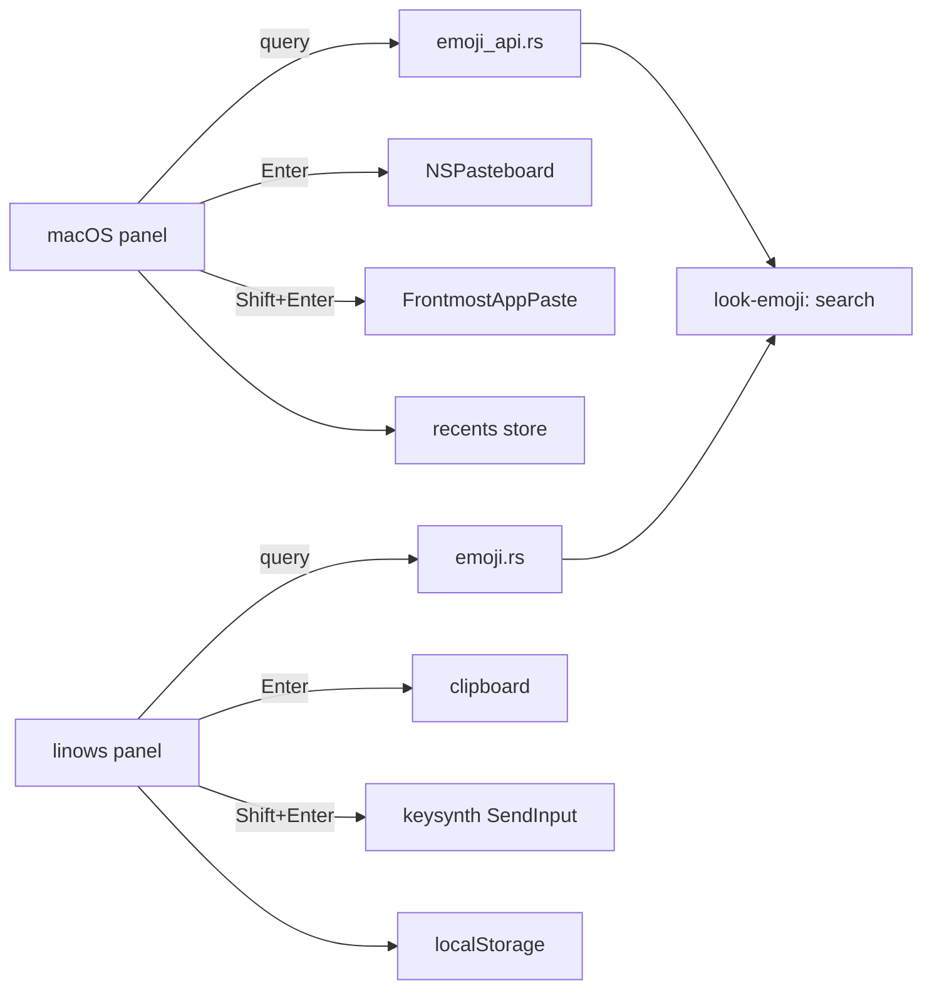

# Architecture & Technical Design

## 1. Overview & Invariants
`/emoji` follows the `/calc` shape: a pure Rust crate `core/emoji` (`look-emoji`) holds the dataset and search; thin shells expose it (C-ABI JSON on macOS, a Tauri command on linows) and own all I/O (clipboard, paste, recents persistence, UI).

Invariants:
- `core/emoji` does no I/O, networking or framework calls; it is deterministic for a given `(query, limit)`.
- Both platforms call the same `search` function, so results cannot diverge (REQ-EMOJI-1).
- Recents are a platform-side list of emoji strings (max 20, most recent first, de-duplicated); search never reads them.
- Insert (Shift+Enter) always copies first, so the fallback to copy-only is the same code path minus the paste (REQ-EMOJI-4).
- No network access at runtime; the dataset is compiled in (NFR-EMOJI-1).

## 2. Domain Models, State & Interface Contracts
```rust
// look_emoji
pub struct Emoji { pub glyph: &'static str, pub name: &'static str, pub keywords: &'static [&'static str] }
pub struct EmojiHit { pub glyph: String, pub name: String }   // serde::Serialize
pub fn search(query: &str, limit: usize) -> Vec<EmojiHit>;     // empty query -> empty Vec
pub fn lookup(glyph: &str) -> Option<EmojiHit>;                // resolves persisted recents to names
```
Matching (ASM-GEN-2): lowercase and trim the query; an emoji matches if the name or any keyword contains it. Rank: name-prefix, then name-substring, then keyword match; ties keep dataset order.

Bindings:
- macOS: `look_emoji_search_json(query, limit) -> *mut c_char` in `bridge/ffi/src/emoji_api.rs`, returning a JSON array of hits, using the existing `cstr_to_string` / `store_json_allocation` helpers. Wrapped in `EngineBridge.swift`.
- linows: `#[tauri::command] emoji_search(query: String, limit: usize) -> Vec<EmojiHit>` in `src-tauri/src/emoji.rs`.

Platform state (not in core):
- Recents: macOS uses the persistence mechanism the other commands use (to be confirmed in task 1); linows uses `localStorage` as `/pomo` does. Stored as a JSON array of glyph strings.
- Panel state: query, results, selected index, feedback text.

State transitions: empty query -> recents; non-empty -> `search` results; Enter -> copy -> record recent -> confirm; Shift+Enter -> copy -> record recent -> hide launcher -> paste (or "copied" notice on failure).

## 3. Architecture Diagram & Data Flow


## 4. Boundary Rules & Budgets
- **Pure Core vs. I/O Shell**: `look-emoji` is pure (static data, string matching). Clipboard, paste, hide-launcher, persistence and rendering stay in the platform shells. The FFI and Tauri files only marshal types.
- **Concurrency, Latency & Resource Budgets**:
  - NFR-EMOJI-1: search under 20 ms. The dataset is a static slice (a few thousand entries); a linear scan per keystroke with a result `limit` (e.g. 60) is well within budget. No indexes or threads are needed, so none are added (YAGNI). Search runs synchronously on the caller thread.
  - Memory: dataset is in read-only static memory; no per-query allocation beyond the result vector.
  - UI: results render on keystroke without a debounce; the list is capped by `limit` to keep frame time low.

## 5. Testing Strategy
1. **BDD Scenarios**: one test per spec scenario, named after it. Core scenarios (name match, keyword match, empty query, no match) in Rust; copy, insert, insertion-denied fallback, recents ordering, cap and restart persistence as shell-level tests where existing test targets allow (`LauncherLogicTests`, linows `tests/*.test.js`).
2. **Unit Tests (>= 95% coverage)**: `look-emoji` tests for ranking, case-insensitivity, trimming, limit, empty and unknown queries, and `lookup`; recents logic (de-dup, cap 20, ordering) as small pure functions on each platform. A latency test asserts a full-dataset query stays under the 20 ms budget with margin.
3. **Mutation Testing (100% kill)**: run `cargo mutants` (or the repo's equivalent, if any) on `look-emoji` ranking and matching. If the tool is not already in the repo, adding it is a decision for tasks, not assumed here.

## Review Gate
- [x] **Gate 3 Approval**: Architecture & design reviewed and approved by human before task breakdown.
