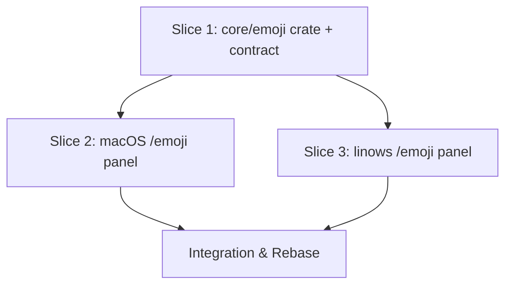

# Tasks

## 1. Dependency DAG

Slices 2 and 3 have no mutual dependency and may run as parallel streams once Slice 1's contract (task 3.0) is committed.

## 2. Streams & Worktrees
| Stream | Worktree Path | Branch | Prerequisite |
| :--- | :--- | :--- | :--- |
| core | `.worktrees/add-emoji-command-core` | `add-emoji-command/core` | none |
| macos | `.worktrees/add-emoji-command-macos` | `add-emoji-command/macos` | 3.0 committed and 3.4 merged |
| linows | `.worktrees/add-emoji-command-linows` | `add-emoji-command/linows` | 3.0 committed and 3.4 merged |

## 3. Slice 1: core/emoji crate (REQ-EMOJI-1, REQ-EMOJI-6 core part, NFR-EMOJI-1)

- [x] 3.0 Contract scaffolding: add `core/emoji` to the workspace; empty `Emoji`, `EmojiHit`, `search`, `lookup` signatures; `bridge/ffi/src/emoji_api.rs` and `apps/linows/src-tauri/src/emoji.rs` stubs (verify: `cargo check` passes)
- [x] 3.1 BDD scenarios for name match, keyword match, empty query, no match, latency (verify: `.feature` committed)
- [x] 3.2 Gate 5.1 human sign-off on BDD scenarios
- [x] 3.3 Red unit tests for ranking, case-insensitivity, trim, limit, `lookup` fail for the expected reason (verify: output shown) — evidence: `cargo test -p look-emoji`: 9 failed (stubs return empty), 3 pass trivially (empty/no-match/latency)
- [x] 3.4 Green: bundle the CLDR-derived dataset (record its source and version) and implement `search` and `lookup`; FFI and Tauri wrappers return JSON hits (verify: `cargo test -p look-emoji` and `cargo clippy --all-targets` pass) — evidence: 12/12 tests pass, clippy clean; dataset = Unicode emoji-test v18.0 + CLDR en.xml, 1597 emoji, generated by `core/emoji/tools/gen_data.py`
- [x] 3.5 Coverage >= 95% and mutation > 90% kill on matching and ranking; full-dataset query under 20 ms asserted in a test (verify: reports; decide whether to add `cargo mutants`) — evidence: `cargo llvm-cov` 100% lines/regions; `cargo mutants` 16 mutants: 12 caught, 4 unviable, 0 missed; latency test asserts <20 ms; `cargo mutants` already installed

## 4. Slice 2: macOS panel (REQ-EMOJI-2 to REQ-EMOJI-6)

- [x] 4.0 Contract scaffolding: `Command.emoji` in `AppConstants.swift`, `EngineBridge` wrapper for `look_emoji_search_json`, `EmojiView` stub, dispatch in `LauncherView+CommandMode.swift`, and the mode entry in `core/engine/src/modes.rs`; confirm the persistence mechanism used by `/todo` and `/pomo` for recents (verify: app builds) (evidence: xcodebuild -scheme Look BUILD SUCCEEDED)
- [x] 4.1 BDD scenarios: open panel, copy, insert, insertion denied, recents order, cap, restart, no match (verify: `.feature` committed)
- [x] 4.2 Gate 5.2 human sign-off on BDD scenarios
- [x] 4.3 Red tests for recents logic (de-dup, cap 20, order) and key handling in `LauncherLogicTests` (verify: output shown) (evidence: swift test --filter EmojiRecentsTests failed "cannot find type EmojiRecents" before the logic existed; key handling sits in the SwiftUI layer, not unit-tested)
- [ ] 4.4 Green: panel UI, Enter copies, Shift+Enter via `FrontmostAppPaste` with copy fallback and notice, recents persisted (verify: `LauncherLogicTests` pass; manual run of `/emoji`) [PENDING HUMAN: xcodebuild BUILD SUCCEEDED, swift test 229/229; needs a manual run of /emoji. Known limit: selection is top-hit only (no arrow navigation), click copies]
- [x] 4.5 Coverage >= 95% on the new pure logic and mutation > 90% kill (verify: reports) (evidence: hand-rolled mutation run on EmojiRecents.swift, 6/6 killed; logic is 3 small pure functions fully exercised by 6 tests; no llvm-cov report for Swift)

## 5. Slice 3: linows panel (REQ-EMOJI-2 to REQ-EMOJI-6)

- [x] 5.0 Contract scaffolding: `emoji` entry in `catalog.js`, `screens/commands/emoji.{html,js}` stubs, `emoji_search` registered in the Tauri handler and `commands/index.js` (verify: app builds)
- [x] 5.1 BDD scenarios as in 4.1 (verify: `.feature` committed)
- [x] 5.2 Gate 5.3 human sign-off on BDD scenarios
- [x] 5.3 Red tests for recents logic and key handling in `apps/linows/tests/*.test.js` (verify: output shown) (evidence: `tests/emoji-recents.test.js` failed with ERR_MODULE_NOT_FOUND before `emoji-logic.js` existed; key handling lives in the DOM panel and is covered only by the manual run in 5.4)
- [ ] 5.4 Green: panel UI, Enter copies, Shift+Enter via `keysynth.rs` with copy fallback and notice, recents in `localStorage` (verify: `node --test` suite passes; manual run of `/emoji`) [PENDING HUMAN: node --test 49/49; needs a manual run of /emoji in the Tauri app, which cannot be built on this Mac]
- [x] 5.5 Coverage >= 95% on the new logic and mutation > 90% kill (verify: reports) (evidence: node --experimental-test-coverage emoji-logic.js 100%; hand-rolled mutation run 9/9 killed after tightening the malformed-entry test)

## 6. Integration & Rebase Plan
- [ ] 6.1 Human Comprehension Verification: reviewer can explain all generated logic line-by-line
- [ ] 6.2 Merge streams, rebase on main, re-verify rails and docs (`docs/features.md`, `docs/user-guide.md`, `docs/wiki/Commands-and-Actions.md`), then `openspec archive`

## Review Gate
- [x] **Gate 4 Approval**: Tasks breakdown approved by human before writing test code.
